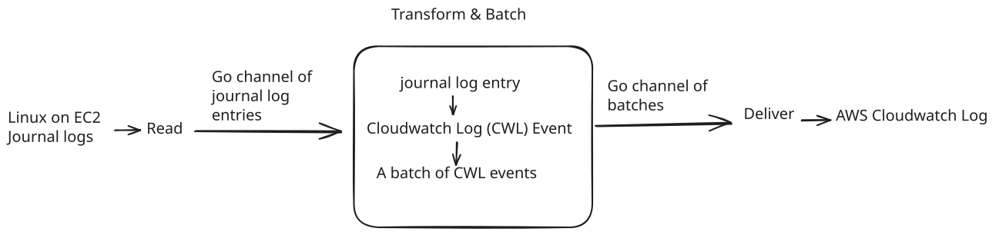

# journald-to-cwl

[](https://github.com/pengubco/journald-to-cwl/actions/workflows/ci.yml)

`journald-to-cwl` ships journald logs from an EC2 instance to Amazon CloudWatch Logs (CWL). It runs as a systemd
service and is a linear Extract → Transform → Load pipeline: read the journal, turn entries into JSON log events,
send them in batches.



It is deliberately small:

- The log group is in the same AWS account and region as the instance.
- Credentials come from the EC2 instance profile.
- The only argument is the path to a TOML configuration file.

## Requirements

- An EC2 instance with systemd and access to the instance metadata service (IMDS), which supplies the region and
  instance ID.
- An existing CWL log group. `journald-to-cwl` creates the log stream but not the log group.
- An instance profile that allows `logs:CreateLogStream` and `logs:PutLogEvents` on that log group.

## Configuration

`/etc/journald-to-cwl/journald-to-cwl.conf`, with every key optional:

```toml
log_group = "journal-logs"                     # default: "journal-logs"
log_stream = ""                                # default: the instance ID, e.g. "i-0123456789abcdef0"
state_file = "/var/lib/journald-to-cwl/state"  # default; stores the journal cursor
skip_audit_log = false                         # true drops entries with _TRANSPORT=audit

# Drop entries whose MESSAGE field matches any of these regular expressions (Go RE2 syntax).
# An invalid pattern stops the program at startup.
ignore_patterns = [
    "^DEBUG:",
    "connection reset",
]
```

## Installation

Build from source. You need Go 1.25 or newer; the go command downloads the exact toolchain pinned in `go.mod`
automatically. The build uses cgo, so it also needs gcc and the systemd headers.

```sh
# Amazon Linux, Fedora, RHEL
sudo yum install -y gcc make systemd-devel
# Debian, Ubuntu
sudo apt-get install -y gcc make libsystemd-dev

make build-go   # writes build/journald-to-cwl
```

To build an RPM that installs the binary, the systemd unit and a default configuration file:

```sh
sudo yum install -y rpmdevtools
make build-rpm  # writes rpmbuild/RPMS/<arch>/journald-to-cwl-<version>-1.<dist>.<arch>.rpm
sudo rpm -ivh rpmbuild/RPMS/*/journald-to-cwl-*.rpm
```

Then edit the configuration if needed and start the service:

```sh
sudoedit /etc/journald-to-cwl/journald-to-cwl.conf
sudo systemctl enable --now journald-to-cwl
```

## Log events

Each journal entry becomes one JSON log event:

```json
{
    "instanceId": "i-0123456789abcdef0",
    "realTimestamp": 1728886624050615,
    "pid": 10993,
    "uid": 1000,
    "gid": 0,
    "cmdName": "sudo",
    "exe": "/usr/bin/sudo",
    "systemdUnit": "session-1.scope",
    "bootId": "a1111111111111111111111111111111",
    "machineId": "b1111111111111111111111111111111",
    "hostname": "ip-10-0-1-23.us-west-2.compute.internal",
    "transport": "syslog",
    "priority": "info",
    "message": "pam_unix(sudo:session): session closed for user root",
    "syslog": {
        "facility": 10,
        "ident": "sudo"
    }
}
```

The CWL event timestamp is the time `journald-to-cwl` read the entry. The time journald recorded is in
`realTimestamp`, in microseconds since the Unix epoch.

## Delivery and failure handling

- A batch is sent when it reaches 1,000 events or about 900 KiB, or 2 seconds after it was started. A single event
  larger than a batch is cut to its first 500 bytes.
- PutLogEvents requires the events in one request to be in time order. If the system clock is set back, for example
  by an NTP correction, the current batch is closed and a new one started.
- The journal cursor is saved after each batch is accepted, and a restart resumes from it. Delivery is at least once:
  a batch that was sent but whose cursor was not saved is sent again.
- Throttled requests are retried for as long as it takes. Network errors and CWL server errors are retried with
  backoff for up to 15 minutes per batch; after that, and on any error CWL attributes to the request (for example
  missing permissions or a missing log group), the program exits and systemd restarts it.
- At startup, IMDS is tried up to 10 times over about 90 seconds before the program exits.
- Journal entries that journald rotates away before they are sent, for example during a long outage, are lost.

## FAQ

**Where do the logs of journald-to-cwl itself go?**

To journald, unless the systemd unit sets `StandardOutput`/`StandardError`, so `journald-to-cwl` also ships its own
logs. That is why it logs little: one line per retry, with the pause between retries growing to 30 seconds.

**Why not the CloudWatch agent, OpenTelemetry or Vector?**

The [CloudWatch agent](https://docs.aws.amazon.com/AmazonCloudWatch/latest/monitoring/Install-CloudWatch-Agent.html)
does not read the journal. [OpenTelemetry](https://opentelemetry.io/) and [Vector](https://vector.dev/) do, but they
are general-purpose pipelines with much more to configure and run. `journald-to-cwl` does one thing.

**How does it compare with [saymedia/journald-cloudwatch-logs](https://github.com/saymedia/journald-cloudwatch-logs)?**

That project has had no commits since 2017. It uses
[aws-sdk-go v1](https://github.com/aws/aws-sdk-go?tab=readme-ov-file#warning-this-sdk-is-in-maintenance-mode), which
reached end of support on July 31, 2025; it does not build with Go 1.22 or newer, because it depends on a
`Gopkg.lock` that [`go mod init` no longer imports](https://go.dev/doc/go1.22); and it has no releases, license or
tests.

## Development

```sh
make test       # unit tests with the race detector
make lint       # needs golangci-lint v2.15.0, the version CI uses
make update-go  # pin the latest stable Go toolchain in go.mod, then lint and test
```

The code follows the three pipeline stages, connected by two channels and stopped by one shared context:
`journal/reader.go` reads entries, `batch/batch.go` converts and batches them, and `cwl/writer.go` sends the batches.
GitHub Actions runs the tests and the linter on every push to `main` and on every pull request.
